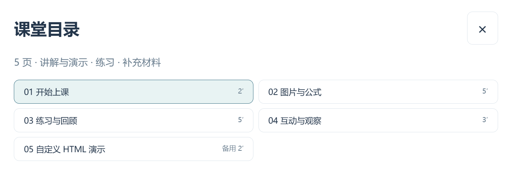
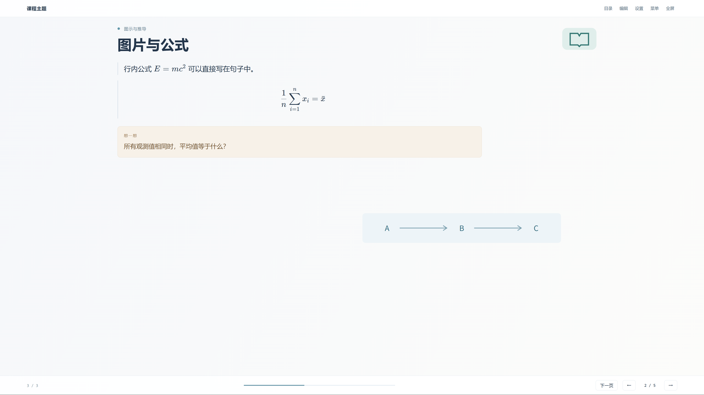

# YetToTell · 讲未

*Turn your notes into lessons, one step at a time.*  
*把笔记变成课程，让内容跟随讲述逐步展开。*

一个面向备课、讲课与知识分享的本地授课工具。用 Markdown 留下内容，用 Agent 协助准备，用浏览器完成展示，再把课堂上的调整带回下一次备课。

[快速开始](#-从第一节课开始) · [使用说明](docs/usage.md) · [目录结构](docs/structure.md) · [参与维护](#-欢迎一起把讲未做好)

## 🌱 从一次辅导开始

讲未最初来自一个很朴素的念头：给别人辅导时，备课和做课件实在有些麻烦。

想把一节课讲清楚，要准备知识点、例子、练习，也要考虑学生在哪一步可能听不懂。做成 PPT 后，又多了一批细碎的工作：拆页面、挪文字、调字号、放图片，给内容安排合适的出现顺序。改了一个例子，有时还要连着调整几页。

做完这些，才能把课件带进课堂。但备课时，我更想多想一想“这部分怎么讲”。既然已经有大模型和 Agent 可以协助整理材料、写代码、修改文件，能不能让它们多承担一些制作工作，让我从自己的讲课思路出发，就能得到一份可以继续修改的课件？

于是有了最初的工具。起点只是让自己的辅导备课省点事，后来随着功能逐渐补齐，它开始能保存网页上的编辑、展示公式和互动内容，也有了演示者视图与讲义导出。慢慢地，它变成了现在的 **YetToTell · 讲未**。

“讲未”留了一点未完成的意思。一节课讲过以后，往往还会有新的例子、更合适的提问，以及下一次想换一种方式讲的地方。课件也应该允许这些变化轻松发生。

## ✨ 有了想法，就可以开始备课

用 PPT 做课件，很容易同时处理两件事：一边组织要讲的内容，一边照顾每一页的版式。讲未希望把起点往前挪一点。你可以先给出主题、对象、时长和想讲清楚的问题，把整理初稿、拆分页面、补充讲稿与生成演示的工作交给 Agent 协助完成。

你提供一个创意、一段笔记、一个学生经常问的问题，就可以开始。资料还不完整，也可以先让大模型帮你理出提纲，再逐步补充。已有课件以后，修改同样可以通过自然语言提出：这个例子太抽象，换一个；这一页讲得太快，拆成两步；这里加一个能操作的演示，让学生先预测再验证。

**把想法说清楚，把制作交给工具，把时间留给讲述。**

少搬运几次内容，少重复几次排版，少为一次小改动重做一套页面；多准备一个好例子，多留一次提问，多听一听学生是怎样理解的。

讲未提供的是这套协作所需的课程格式、编辑页面和本地运行工具。**项目没有内置模型服务，也不捆绑某个 Agent 平台**。你可以使用能够读写项目文件的 Agent，也可以让普通对话模型生成符合格式的内容，再自行保存。AI 生成的知识、引用和题目答案，仍需要授课者核对。

### 可以这样交给 Agent

把项目放进 Agent 能访问的工作目录，告诉它要讲什么。例如：

```text
请先阅读 README.md、docs/usage.md 和 课程.md，了解课程格式。

我要给零基础学习者讲一节 45 分钟的入门课。
主题：[填写主题]
我希望学生最后能够：[填写具体目标]
已有材料：[提供笔记、参考资料或案例]
我的想法：[描述开场、例子、互动或希望强调的内容]

请修改课程.md，保留稳定的页编号。
学生页面只放需要展示的内容，讲解、答案和操作提示放到教师小节。
按讲述顺序组织逐步展开，给练习和讨论留出时间。
需要互动时优先使用现有控件，不确定的知识或来源请明确提出。

完成后运行 python lesson/build_markdown.py，检查格式与页面效果。
```

这段提示词只是一个起点。可以先做两三页，试讲后再继续；也可以从一份已有笔记逐步扩展。讲未采用明确结构的 Markdown 子集，模型生成的普通 Markdown 需要按课程格式整理。

## 🎙️ 从备课到讲课，再到下一次修改

### 备课时，内容和布局都能继续改

课程正文保存在 `课程.md`。标题、要点、问题、讲稿和答案各有位置，方便自己阅读，也方便 Agent 修改。

打开网页后，原文与独立文字框共用编辑侧栏。可以改字、调字体，也可以拖动文字、图片与互动控件。未调整的原文保留默认位置；调整过的位置与尺寸会保存到 Markdown 中。原文仍按原来的讲解顺序展开，不需要重新设置每一条的出场顺序。

### 讲课时，让画面跟得上讲述

要点可以逐步展开，目录用于跳转，补充页可以按需要使用。演示者视图单独显示讲稿和答案，并控制学生页；全屏模式收起多余工具，让页面留给正在讲的内容。

下面是示例课程的目录，包含主线内容、课堂练习与补充演示。



### 展示时，图片、公式和互动放在同一份课件里

图片可来自本机、课程资源目录或在线地址。公式使用本地 KaTeX 渲染，内置控件支持计数、滑块、选项卡和点击展开，也可以加入自定义 HTML 演示。适合把“先观察，再解释，最后验证”的过程放在一页中。



*以上两张截图来自项目示例课程。*

### 课后，把这一次的修改留住

网页中的文字与布局可以保存回 Markdown。下一次换例子、调节奏、补一个解释，就从这份源文件继续。课程也可以进入 Git 仓库，用版本记录积累修改，而不必依靠一串“最终版”文件名区分。

需要发讲义时，从主页面菜单导出学生版或教师版 PDF，也可指定课件页码。学生版不包含教师讲稿和答案。

## 🧰 目前能做什么

| 环节 | 已有能力 |
| --- | --- |
| 内容组织 | Markdown 课程源、页编号、主线与补充页、讲稿和答案分离 |
| 页面编辑 | 原文与独立文字编辑、拖动、尺寸调整、字体与颜色设置 |
| 图片与公式 | 本机图片导入、在线图片、跨页固定图片、本地 KaTeX |
| 互动演示 | 计数器、滑块、选项卡、点击展开、隔离的自定义 HTML |
| 课堂展示 | 逐步展开、目录、全屏、计时、独立演示者视图 |
| 保存与分享 | Markdown 回写、冲突检查、离线下载源文件、两种 PDF 讲义 |

适合辅导课程、短课、工作坊、技术分享，以及需要按思路逐步展示的讲解。它仍在完善中，复杂出版排版、完整 Markdown 插件生态和多人实时协作不属于当前能力。

## 🚀 从第一节课开始

### 1. 准备课程并生成页面

安装 Python 3.10 或更新版本，解压项目，在项目根目录运行：

```powershell
python lesson/build_markdown.py
```

随后打开生成的 `课件.html`。Windows 下也可以直接双击 **更新课件.cmd**。内置示例可用于熟悉操作，换课时建议复制整个项目，再编辑 `课程.md`。

### 2. 使用网页保存与 PDF 导出

普通网页生成只使用 Python 标准库。PDF 导出另需 Microsoft Edge 和以下依赖：

```powershell
python -m venv .venv
.venv\Scripts\python.exe -m pip install -r requirements.txt
```

双击 **启动课件.cmd**，打开本地服务。启动器会优先使用项目自己的 `.venv`；默认地址是 `http://127.0.0.1:18801/`。

### 3. 上完课，结束服务

双击 **结束服务.cmd**。脚本会核对课程目录和服务身份，只关闭本项目的服务。关闭浏览器标签页本身不会结束后台服务。

如果为多门课程设置了 `CLASSROOM_PORT`，结束服务时也要使用对应的端口环境变量。详细操作见 [使用说明](docs/usage.md)。

| 根目录入口 | 用途 |
| --- | --- |
| `课程.md` | 编辑课程内容 |
| `更新课件.cmd` | 校验并重新生成网页 |
| `启动课件.cmd` | 启动本地编辑与导出服务 |
| `结束服务.cmd` | 核对身份并结束服务 |
| `更新PDF.cmd` | 生成默认匿名学生版与教师版 PDF |

## 📁 内容放在哪里

```text
YetToTell/
├── README.md                 项目介绍与快速开始
├── 课程.md                   课程内容与布局
├── 启动课件.cmd / 结束服务.cmd
├── 更新课件.cmd / 更新PDF.cmd
├── requirements.txt          PDF 导出依赖
├── docs/
│   ├── usage.md              使用说明与 Markdown 格式
│   ├── structure.md          目录分工和维护入口
│   └── images/               README 使用的两张展示图
├── assets/                   课件图片、互动示例、公式库
└── lesson/                   本地服务、构建脚本与网页源码
    └── dist/                 浏览器页面源码
```

文档截图放在 `docs/images/`，上课真正使用的媒体放在 `assets/`。网页和讲义属于生成结果，日常维护从 Markdown 和源码开始。更详细的分工见 [目录结构](docs/structure.md)。

开发工作区另有 `tests/`、`.local/` 和 `.venv/`。最小发布包不包含测试、测试输出、PDF、日志、备份或本机环境；只保留运行所需源码、示例与文档。README 引用的两张展示图会随文档一起保留。

## 使用前了解这几件事

- **离线与本地服务的保存方式不同。** 通过服务打开可直接保存；双击 HTML 时会下载更新后的 Markdown，替换后需要重新生成。
- **本机资源决定离线效果。** 在线图床需要网络。自定义字体保存的是名称，换电脑可能需要安装相同字体；字体文件不随项目分发。
- **HTML 包含演示者数据。** 向学生分发材料请使用学生版 PDF。自定义 HTML 控件导出为预先填写的静态说明。
- **隐藏署名不是证书数字签名。** 签名设置保存在当前浏览器，不写进公开课程。发布自己的课程前，请检查素材与讲稿是否适合公开。
- **这是本机授课工具。** 当前服务仅监听本机地址，不用于直接部署到公网。

## 🤝 欢迎一起把讲未做好

讲未从一个人的辅导需求开始，也希望能容纳更多真实的授课经验。欢迎带着一次不顺手的操作、一个想讲清楚的问题，或者一份愿意分享的课程模板来参与。

发现问题时，可以提供浏览器版本、复现步骤和去除个人信息的最小示例。愿意贡献代码，可以从一个具体的小改进开始：更清楚的编辑反馈、更好的键盘操作、更稳的打印布局，或者一个有教学价值的互动组件。使用说明、示例课程和无障碍方面的改进，同样值得欢迎。

一起维护时，有几件事尤其值得检查：课程源文件能读懂，网页上的修改能保存，学生画面与教师材料分得清楚。让新增功能在真实课堂里经得起使用，比让功能列表更长更有意义。

有些内容还没来得及讲，有些讲法还可以再试一次。希望讲未能陪你把这些想法慢慢留下来。

---

**YetToTell**  
*Every lesson has more to tell.*  
*每一堂课，都还有值得讲述的内容。*
